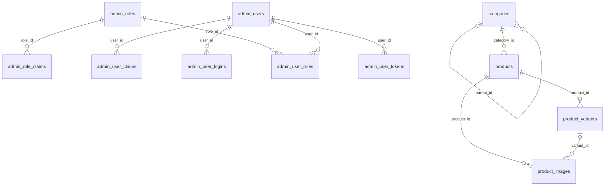

# Схема на базата – Принтко 3Д

> Генериран файл. Не се редактира на ръка.
> Обновява се с `UPDATE_SCHEMA_DOC=1 dotnet test tests/Storefront.IntegrationTests --filter DatabaseSchemaDocumentTests` (изисква Docker). Тестът пропада, когато файлът не съвпада с миграциите.
> Понятията и правилата са в [data-model.md](data-model.md), решението е [0007](decisions/0007-generated-database-schema-document.md).

Последна миграция: `20261109121627_AddAdminIdentity`

## Връзки

## Таблици

### admin_role_claims

| Колона | Тип | NULL | По подразбиране |
| --- | --- | --- | --- |
| id | integer | не |  |
| role_id | uuid | не |  |
| claim_type | text | да |  |
| claim_value | text | да |  |

**Ограничения**

| Име | Вид | Определение |
| --- | --- | --- |
| PK_admin_role_claims | първичен ключ | `PRIMARY KEY (id)` |
| FK_admin_role_claims_admin_roles_role_id | външен ключ | `FOREIGN KEY (role_id) REFERENCES admin_roles(id) ON DELETE CASCADE` |

**Индекси**

| Име | Определение |
| --- | --- |
| IX_admin_role_claims_role_id | `CREATE INDEX "IX_admin_role_claims_role_id" ON public.admin_role_claims USING btree (role_id)` |

### admin_roles

| Колона | Тип | NULL | По подразбиране |
| --- | --- | --- | --- |
| id | uuid | не |  |
| name | character varying(256) | да |  |
| normalized_name | character varying(256) | да |  |
| concurrency_stamp | text | да |  |

**Ограничения**

| Име | Вид | Определение |
| --- | --- | --- |
| PK_admin_roles | първичен ключ | `PRIMARY KEY (id)` |

**Индекси**

| Име | Определение |
| --- | --- |
| RoleNameIndex | `CREATE UNIQUE INDEX "RoleNameIndex" ON public.admin_roles USING btree (normalized_name)` |

### admin_user_claims

| Колона | Тип | NULL | По подразбиране |
| --- | --- | --- | --- |
| id | integer | не |  |
| user_id | uuid | не |  |
| claim_type | text | да |  |
| claim_value | text | да |  |

**Ограничения**

| Име | Вид | Определение |
| --- | --- | --- |
| PK_admin_user_claims | първичен ключ | `PRIMARY KEY (id)` |
| FK_admin_user_claims_admin_users_user_id | външен ключ | `FOREIGN KEY (user_id) REFERENCES admin_users(id) ON DELETE CASCADE` |

**Индекси**

| Име | Определение |
| --- | --- |
| IX_admin_user_claims_user_id | `CREATE INDEX "IX_admin_user_claims_user_id" ON public.admin_user_claims USING btree (user_id)` |

### admin_user_logins

| Колона | Тип | NULL | По подразбиране |
| --- | --- | --- | --- |
| login_provider | text | не |  |
| provider_key | text | не |  |
| provider_display_name | text | да |  |
| user_id | uuid | не |  |

**Ограничения**

| Име | Вид | Определение |
| --- | --- | --- |
| PK_admin_user_logins | първичен ключ | `PRIMARY KEY (login_provider, provider_key)` |
| FK_admin_user_logins_admin_users_user_id | външен ключ | `FOREIGN KEY (user_id) REFERENCES admin_users(id) ON DELETE CASCADE` |

**Индекси**

| Име | Определение |
| --- | --- |
| IX_admin_user_logins_user_id | `CREATE INDEX "IX_admin_user_logins_user_id" ON public.admin_user_logins USING btree (user_id)` |

### admin_user_roles

| Колона | Тип | NULL | По подразбиране |
| --- | --- | --- | --- |
| user_id | uuid | не |  |
| role_id | uuid | не |  |

**Ограничения**

| Име | Вид | Определение |
| --- | --- | --- |
| PK_admin_user_roles | първичен ключ | `PRIMARY KEY (user_id, role_id)` |
| FK_admin_user_roles_admin_roles_role_id | външен ключ | `FOREIGN KEY (role_id) REFERENCES admin_roles(id) ON DELETE CASCADE` |
| FK_admin_user_roles_admin_users_user_id | външен ключ | `FOREIGN KEY (user_id) REFERENCES admin_users(id) ON DELETE CASCADE` |

**Индекси**

| Име | Определение |
| --- | --- |
| IX_admin_user_roles_role_id | `CREATE INDEX "IX_admin_user_roles_role_id" ON public.admin_user_roles USING btree (role_id)` |

### admin_user_tokens

| Колона | Тип | NULL | По подразбиране |
| --- | --- | --- | --- |
| user_id | uuid | не |  |
| login_provider | text | не |  |
| name | text | не |  |
| value | text | да |  |

**Ограничения**

| Име | Вид | Определение |
| --- | --- | --- |
| PK_admin_user_tokens | първичен ключ | `PRIMARY KEY (user_id, login_provider, name)` |
| FK_admin_user_tokens_admin_users_user_id | външен ключ | `FOREIGN KEY (user_id) REFERENCES admin_users(id) ON DELETE CASCADE` |

### admin_users

| Колона | Тип | NULL | По подразбиране |
| --- | --- | --- | --- |
| id | uuid | не |  |
| user_name | character varying(256) | да |  |
| normalized_user_name | character varying(256) | да |  |
| email | character varying(256) | да |  |
| normalized_email | character varying(256) | да |  |
| email_confirmed | boolean | не |  |
| password_hash | text | да |  |
| security_stamp | text | да |  |
| concurrency_stamp | text | да |  |
| phone_number | text | да |  |
| phone_number_confirmed | boolean | не |  |
| two_factor_enabled | boolean | не |  |
| lockout_end | timestamp with time zone | да |  |
| lockout_enabled | boolean | не |  |
| access_failed_count | integer | не |  |

**Ограничения**

| Име | Вид | Определение |
| --- | --- | --- |
| PK_admin_users | първичен ключ | `PRIMARY KEY (id)` |

**Индекси**

| Име | Определение |
| --- | --- |
| EmailIndex | `CREATE INDEX "EmailIndex" ON public.admin_users USING btree (normalized_email)` |
| UserNameIndex | `CREATE UNIQUE INDEX "UserNameIndex" ON public.admin_users USING btree (normalized_user_name)` |

### categories

| Колона | Тип | NULL | По подразбиране |
| --- | --- | --- | --- |
| id | uuid | не |  |
| parent_id | uuid | да |  |
| name | character varying(200) | не |  |
| slug | character varying(200) | не |  |
| description | character varying(2000) | да |  |
| image_key | character varying(500) | да |  |
| sort_order | integer | не |  |
| is_active | boolean | не |  |
| created_at | timestamp with time zone | не |  |
| updated_at | timestamp with time zone | не |  |

**Ограничения**

| Име | Вид | Определение |
| --- | --- | --- |
| PK_categories | първичен ключ | `PRIMARY KEY (id)` |
| FK_categories_categories_parent_id | външен ключ | `FOREIGN KEY (parent_id) REFERENCES categories(id) ON DELETE RESTRICT` |

**Индекси**

| Име | Определение |
| --- | --- |
| IX_categories_parent_id | `CREATE INDEX "IX_categories_parent_id" ON public.categories USING btree (parent_id)` |
| IX_categories_slug | `CREATE UNIQUE INDEX "IX_categories_slug" ON public.categories USING btree (slug)` |

### data_protection_keys

| Колона | Тип | NULL | По подразбиране |
| --- | --- | --- | --- |
| id | integer | не |  |
| friendly_name | text | да |  |
| xml | text | да |  |

**Ограничения**

| Име | Вид | Определение |
| --- | --- | --- |
| PK_data_protection_keys | първичен ключ | `PRIMARY KEY (id)` |

### product_images

| Колона | Тип | NULL | По подразбиране |
| --- | --- | --- | --- |
| id | uuid | не |  |
| product_id | uuid | не |  |
| variant_id | uuid | да |  |
| storage_key | character varying(500) | не |  |
| alt_text | character varying(300) | не |  |
| sort_order | integer | не |  |
| is_primary | boolean | не |  |
| created_at | timestamp with time zone | не |  |
| updated_at | timestamp with time zone | не |  |

**Ограничения**

| Име | Вид | Определение |
| --- | --- | --- |
| PK_product_images | първичен ключ | `PRIMARY KEY (id)` |
| FK_product_images_product_variants_variant_id | външен ключ | `FOREIGN KEY (variant_id) REFERENCES product_variants(id) ON DELETE RESTRICT` |
| FK_product_images_products_product_id | външен ключ | `FOREIGN KEY (product_id) REFERENCES products(id) ON DELETE RESTRICT` |

**Индекси**

| Име | Определение |
| --- | --- |
| IX_product_images_variant_id | `CREATE INDEX "IX_product_images_variant_id" ON public.product_images USING btree (variant_id)` |
| ux_product_images_one_primary_per_product | `CREATE UNIQUE INDEX ux_product_images_one_primary_per_product ON public.product_images USING btree (product_id) WHERE is_primary` |

### product_variants

| Колона | Тип | NULL | По подразбиране |
| --- | --- | --- | --- |
| id | uuid | не |  |
| product_id | uuid | не |  |
| sku | character varying(100) | не |  |
| name | character varying(200) | не |  |
| price | bigint | не |  |
| compare_at_price | bigint | да |  |
| stock_quantity | integer | да |  |
| weight_grams | integer | не |  |
| attributes | jsonb | не |  |
| is_active | boolean | не |  |
| sort_order | integer | не |  |
| created_at | timestamp with time zone | не |  |
| updated_at | timestamp with time zone | не |  |

**Ограничения**

| Име | Вид | Определение |
| --- | --- | --- |
| PK_product_variants | първичен ключ | `PRIMARY KEY (id)` |
| FK_product_variants_products_product_id | външен ключ | `FOREIGN KEY (product_id) REFERENCES products(id) ON DELETE RESTRICT` |
| ck_product_variants_compare_at_price | проверка | `CHECK (((compare_at_price IS NULL) OR (compare_at_price >= 0)))` |
| ck_product_variants_price | проверка | `CHECK ((price >= 0))` |
| ck_product_variants_stock_quantity | проверка | `CHECK (((stock_quantity IS NULL) OR (stock_quantity >= 0)))` |

**Индекси**

| Име | Определение |
| --- | --- |
| IX_product_variants_product_id | `CREATE INDEX "IX_product_variants_product_id" ON public.product_variants USING btree (product_id)` |
| IX_product_variants_sku | `CREATE UNIQUE INDEX "IX_product_variants_sku" ON public.product_variants USING btree (sku)` |

### products

| Колона | Тип | NULL | По подразбиране |
| --- | --- | --- | --- |
| id | uuid | не |  |
| category_id | uuid | не |  |
| name | character varying(200) | не |  |
| slug | character varying(200) | не |  |
| short_description | character varying(200) | не |  |
| description | text | не |  |
| fulfilment_type | character varying(20) | не |  |
| lead_time_days | integer | да |  |
| status | character varying(20) | не |  |
| seo_title | character varying(200) | да |  |
| seo_description | character varying(500) | да |  |
| created_at | timestamp with time zone | не |  |
| updated_at | timestamp with time zone | не |  |

**Ограничения**

| Име | Вид | Определение |
| --- | --- | --- |
| PK_products | първичен ключ | `PRIMARY KEY (id)` |
| FK_products_categories_category_id | външен ключ | `FOREIGN KEY (category_id) REFERENCES categories(id) ON DELETE RESTRICT` |
| ck_products_fulfilment_type | проверка | `CHECK (((fulfilment_type)::text = ANY ((ARRAY['InStock'::character varying, 'MadeToOrder'::character varying])::text[])))` |
| ck_products_lead_time_for_made_to_order | проверка | `CHECK ((((fulfilment_type)::text <> 'MadeToOrder'::text) OR (lead_time_days IS NOT NULL)))` |
| ck_products_status | проверка | `CHECK (((status)::text = ANY ((ARRAY['Draft'::character varying, 'Published'::character varying, 'Archived'::character varying])::text[])))` |

**Индекси**

| Име | Определение |
| --- | --- |
| IX_products_category_id_status | `CREATE INDEX "IX_products_category_id_status" ON public.products USING btree (category_id, status)` |
| IX_products_slug | `CREATE UNIQUE INDEX "IX_products_slug" ON public.products USING btree (slug)` |

### store_settings

| Колона | Тип | NULL | По подразбиране |
| --- | --- | --- | --- |
| id | uuid | не |  |
| store_name | character varying(200) | не |  |
| default_currency | character varying(3) | не |  |
| default_locale | character varying(10) | не |  |
| contact_email | character varying(320) | не |  |
| contact_phone | character varying(50) | не |  |
| logo_key | character varying(500) | да |  |
| primary_color | character varying(20) | не |  |
| is_demo | boolean | не |  |
| created_at | timestamp with time zone | не |  |
| updated_at | timestamp with time zone | не |  |

**Ограничения**

| Име | Вид | Определение |
| --- | --- | --- |
| PK_store_settings | първичен ключ | `PRIMARY KEY (id)` |
| ck_store_settings_single_row | проверка | `CHECK ((id = '0195a000-0000-7000-8000-000000000001'::uuid))` |
